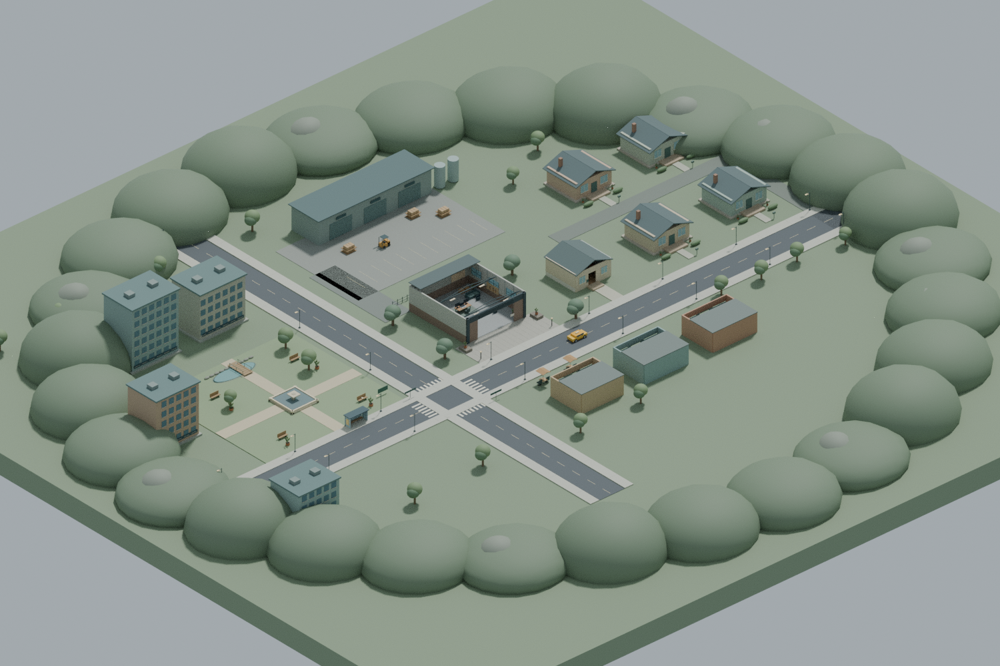
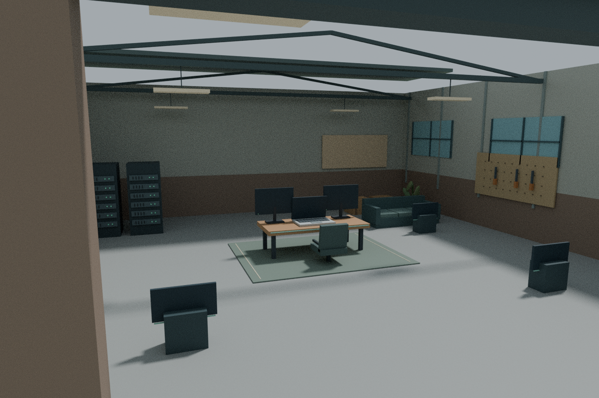

# Roblox Game Downloads

## Latest: Start Your Own Clothing Company V4

**[Download Clothing Company V4 ZIP](https://github.com/supportswervemoto-max/ggg/raw/refs/heads/roblox-v2-download/downloads/StartYourOwnClothingCompany-V4.zip)**

Extract it, then open **StartYourOwnClothingCompany-V4.rbxlx** through Roblox Studio's **File → Open from File**. This is the new clothing-company concept: create a website, build clothing workstations, hire fulfilment employees, advertise, complete business days, and grow to a $1,000,000 company. The live top-right HUD displays `[Username]'s Company` and its balance.

All fashion labels in the prototype are fictional. V4 has a separate source folder at [`roblox-v4`](../roblox-v4). Progress currently resets when the server closes, and Roblox Studio playtesting is still required.

---

# Previous AI Bot Prototype Downloads

## Latest: V3 / The Neighborhood Update

**[Download V3 ZIP](https://github.com/supportswervemoto-max/ggg/raw/refs/heads/roblox-v2-download/downloads/StartYourOwnAIBot-V3.zip)**

Extract it, then open **StartYourOwnAIBot-V3.rbxlx** in Roblox Studio using **File → Open from File**. Press Play. No plugins or npm required.

V3 fixes V2's incorrect Block/Ball XML shape values, which made the ground render as an ellipsoid. The new map has a flat anchored 640 × 600 stud foundation and more than 1,800 modeled parts: houses, streets, shops, a park, offices, a warehouse and a loading yard. There is a neighborhood guide and three collectible research notebooks.

Read the README inside the ZIP for controls, scope and the Studio test checklist. Source is in [`roblox-v3`](../roblox-v3).

### Geometry previews

These are Blender renders of the **exported XML geometry**, not Roblox Studio screenshots. They verify layout and shape export, but do not reproduce Roblox UI, lighting, signs or runtime behavior.

### Validation

Shape/material values checked against Roblox API definitions; flat collidable block ground checked; Lua-compatible syntax, package parity and server behavior tests passed. Roblox Studio playtesting is still required. Progress does not yet persist between sessions.

V2 files remain here for history. **Use V3**, not the old V2 place.
